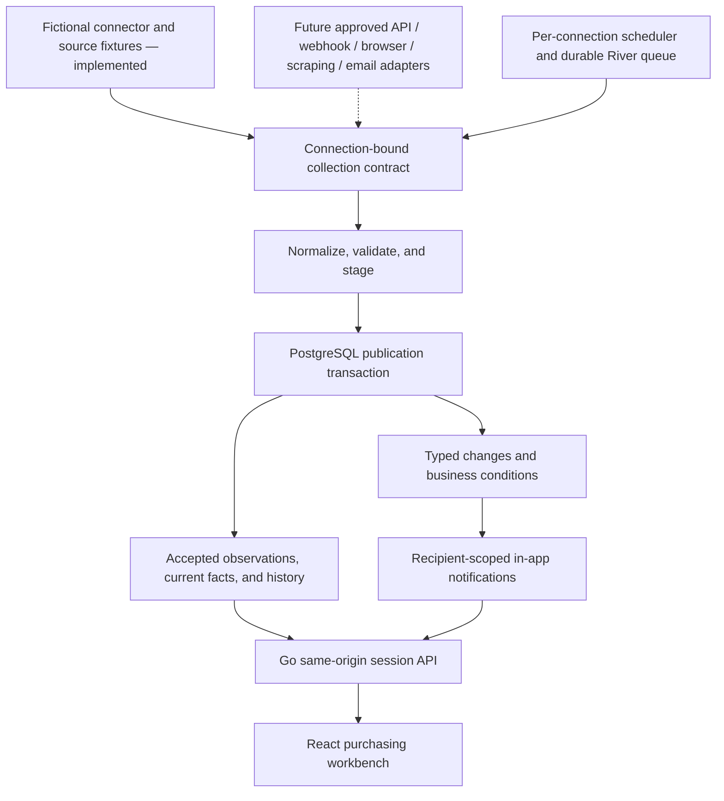

# BuyersWorkBench

BuyersWorkBench is a purchasing intelligence application and learning project built with Go, PostgreSQL, and React/TypeScript. It turns validated supplier observations into delivery exceptions, order history, buyer follow-up work, and in-app notifications.

The project explores how reliable ingestion, background processing, data isolation, and a useful purchasing interface fit together. Its central design principle is that collection methods should be interchangeable: an eventual API, webhook, browser, public-page, or email connector should feed the same normalized storage and event pipeline.

**The runnable data source today is explicitly fictional.** It uses the real database, collection worker, validation, change detection, and notification path. Live Lenovo order collection is deferred. Selecting a real collection method creates an unconfigured connection; it does not authenticate to a supplier or collect data.

## What is implemented

| Area | Current behavior |
|---|---|
| Buyer Priorities | Source-backed exceptions, assignment, acknowledgment, notes, follow-up dates, and structured resolution with verification history |
| Orders | Accepted supplier order-line facts, source-account labels, observation history, and detected changes |
| Supplier Performance | Editable supplier directory, observed activity and coverage; measures stay unavailable when supporting evidence is missing |
| Quote Comparison | Persistent offer edits, exact server-side cost calculations, and explicit eligibility trade-offs |
| Internal purchasing | Draft orders, approval, recorded outside-app placement, partial/full receipts, closure, and cancellation with revision checks and history |
| Connections / Data Health | Named connections, independent source identities, collection runs, refresh, pause, schedules, and validation/failure evidence |
| Additional fictional feeds | Downloadable JSON template and owner-controlled uploads through the common ingestion pipeline |
| Changes and notifications | Typed append-only source events, deduplicated in-app notices, buyer routing, and per-member preferences |
| Demo Controls | Eight source scenarios and a confirmed, generation-aware reset |
| Account isolation | Local owner provisioning, isolated invited accounts, session lifecycle, expiry, and workspace row-level security |
| Local administration | One-off migrations, encrypted backups, isolated restore checks, an encrypted credential vault, and explicit bounded retention tools |

Creating an internal purchase order or recording its placement sends nothing to a supplier. Internal receipts, supplier-reported shipments, and buyer task completion are separate records with separate meanings.

## Architecture



The API, worker, and administration CLI share one Go module. PostgreSQL stores both domain records and River's durable queue. The frontend uses the same-origin application API rather than talking directly to suppliers.

A collection run stages a bounded normalized batch, checks identity and completeness, compares it with accepted observations, and publishes facts, history, conditions, and notifications together. Rejected or failed collection retains the last accepted facts. A first baseline does not invent an earlier transition, and repeating unchanged data does not create duplicate material-change notifications.

Records belong to a workspace, generation, and connection. This allows two supplier accounts to use the same external order number without merging their evidence. Collection leases and publication fences prevent superseded, paused, or pre-reset work from replacing current data. Generation and revision checks also reject stale browser edits.

The current publisher expects complete batches for a declared scope. Partial webhook deliveries and incremental updates need a separate validated contract or a reconciliation request before they can safely update accepted facts. See the [collection strategy](docs/COLLECTION_STRATEGY.md).

## Run locally

For the containerized application, install Docker Engine/Desktop with Docker Compose, Python 3, Make, and a shell compatible with the scripts. Host-side development checks additionally use Go **1.26.5** and Node.js **24.19.0** with npm. The Dockerfiles, Go module, Node version file, and dependency locks record the selected versions.

```sh
git clone https://github.com/AaronCampbellit/BuyersWorkBench.git
cd BuyersWorkBench
cp .env.example .env
make dev
make owner
make status
```

Open [http://127.0.0.1:4180](http://127.0.0.1:4180), sign in with the owner account you just provisioned, select the fictional workspace, and choose **Initialize fictional workbench**. Initialization queues collection; the interface becomes ready after a validated baseline is published. The private workspace remains empty until an authorized live connector is implemented.

`make dev` creates project-local database credentials if absent, builds the containers, runs the one-off migration dependency, and starts the API, worker, and development frontend. API and worker processes never migrate the database themselves. Existing database credential files are preserved.

`make owner` requires an interactive terminal. It prompts for your email, display name, and a password of at least 14 characters, using a restricted temporary password file. Repeating provisioning for the same email preserves the existing credentials. There are no default account credentials or public registration.

The default published web port is loopback only; PostgreSQL and the API have no host port bindings. Set `BWB_WEB_PORT` and the matching `APP_ORIGIN` in the ignored `.env` if another port is needed. An optional browser forwarding address must be listed exactly in `APP_DEV_ALLOWED_ORIGINS`; development accepts explicit HTTP loopback aliases only.

To stop without deleting the database or credentials:

```sh
make down
```

Preserve `.local/` and the PostgreSQL volume between runs. Use the application's reset control to reset fictional data.

## Explore the application

After initialization, open **Buyer Priorities** and inspect an issue. Save a note, assign a buyer, or set a follow-up date, then reload to confirm persistence. **Demo Controls** changes fictional source facts and queues collection; the rules derive the resulting work.

| Scenario | What it exercises |
|---|---|
| SC01 — Baseline | Restore the four seeded source lines and collect their facts |
| SC02 — Delivery delay | Move an arrival commitment and derive delivery risk |
| SC03 — Partial shipment | Preserve the difference between shipped, remaining, and received quantities |
| SC04 — Confirmation restored | Collect new confirmation evidence while retaining buyer notes |
| SC05 — Source failure | Keep accepted facts when a collection fails |
| SC06 — Quote trade-off | Explore cost, approval, and arrival eligibility |
| SC07 — Repeat unchanged | Advance collection freshness without duplicate material changes |
| SC08 — Recovery | Detect improved source evidence and update the active risk |

The fictional business date is fixed at **October 19, 2026** for repeatable scenarios. Actual collection and run timestamps use actual UTC time. Seeded purchasing examples are fictional, including prices, quantities, supplier activity, and exceptions.

In **Quote Comparison**, edit an offer and inspect the persisted server calculation. Eligible offers can create an internal draft purchase order. Internal orders have an explicit lifecycle and do not modify supplier observations or perform supplier transactions.

### Add another fictional source

In the fictional workspace, open **Connections / Data Health**, create a fictional connection, and give it a useful source-account name. Additional feeds start empty. Download the JSON template, edit fictional order records and optional internal requirements, and upload it to that connection.

The source request is validated and queued; its acceptance is distinct from a successful collection. Inspect the returned run and the accepted order history. Identical external keys in different connections stay separate, and the Orders view displays the connection name.

Each runnable connection has its own cadence, minimum interval, pause state, and run evidence. Pausing cancels/fences outstanding collection and disables its schedule. Resuming leaves scheduling disabled until explicitly enabled. Real methods in a private workspace remain unconfigured and cannot refresh or schedule.

Notification preferences control future in-app status and condition notices for the current member and workspace. Routing considers an eligible assignee or connection buyer before a fallback to eligible members; an opted-out assigned recipient does not cause an automatic broadcast.

### Reset fictional data

The confirmed reset advances the selected demo workspace's generation, restores its default seed, and queues a new baseline. It clears additional fictional source payloads and their collection health, clears generation-specific supplier bindings and fictional pause flags, and disables schedules. Connection identities, names, methods, cadence and default buyers remain, alongside member notification preferences and prior historical evidence.

Reset leaves private connections, credentials, accounts, and memberships intact. Old collection work cannot publish into the new generation. Do not delete the database volume or `.local/` as a reset procedure.

## Development and verification

| Command | Purpose |
|---|---|
| `make dev` | Prepare local database credentials, build, migrate once, and start the local stack |
| `make owner` | Provision the owner through a hidden interactive password prompt |
| `make status` | Inspect schema, queue, and workspace metadata with the local admin tool |
| `make logs` | Read bounded API, worker, and frontend logs |
| `make migrate` | Run the explicit one-off migration command |
| `make test` | Run Go tests; database tests skip without explicit integration configuration |
| `make test-integration` | Run the Go suite against a fresh disposable PostgreSQL container |
| `make web-check` | Install locked frontend dependencies, type-check, and build production assets |
| `make check` | Run Go tests, the frontend check, and `go vet` |
| `make backup` | Encrypt a local database dump without a plaintext dump file |
| `make restore-test` | Rehearse restore into an isolated disposable PostgreSQL container |
| `make down` | Stop the local application while preserving its data volume |

The integration script creates its own PostgreSQL container with a random loopback port and removes only that container afterward. It does not reset the running application. Coverage includes publication/rollback, connection isolation, replay handling, pause/reset fencing, notification routing, workspace RLS, account lifecycle, purchasing workflows, and retention boundaries.

Additional focused checks are available:

```sh
go test -race ./internal/secretvault ./internal/collection ./cmd/bwb
BWB_TEST_RESTORE_SQL=1 python3 scripts/test-restore-sql.py -v
```

The restore SQL tests use disposable databases to check version-compatible sanitation and constrained-role visibility. Browser verification, deployment checks, and live-source checks are recorded separately in [build status](docs/BUILD_STATUS.md); a successful fictional collection is not a live supplier test.

For updates to an existing stack, follow the [coordinated operations procedure](docs/OPERATIONS.md): back up, verify the change, build matching images, stop API/worker processes, run the one-off migration, and restart. Do not run mixed application/schema versions or edit an already applied migration.

## Authentication, data boundaries, and administration

- API and worker use the constrained `bwb_app` database role. Administrative credentials belong only to local setup/migration tools. Purchasing access uses verified actor context and workspace/generation row-level security.
- Sessions use opaque tokens, HttpOnly/SameSite cookies, idle and absolute expiry, origin/CSRF checks, and Secure cookies in the HTTPS profile. Password changes, account disablement, and expiry affect session access.
- Invited accounts are provisioned locally with restricted password files, isolated fictional workspaces, expiry, and mandatory first-use password changes. See [operations](docs/OPERATIONS.md).
- Private-to-presentation sharing requires explicit sanitization preview/approval and recent password confirmation. Approved projections do not copy private raw observations or sessions.
- `.env`, `.local/`, credentials, browser state, dumps, diagnostics, and build products stay outside Git. Imported planning archives are preserved locally and excluded from this public source distribution.
- The optional [credential vault](docs/CREDENTIALS.md) stores connection-bound encrypted values using a local key. It currently has no frontend secret input or collector runtime integration. Its key and encrypted files require separate recovery handling from PostgreSQL backups.
- [Retention tools](docs/RETENTION.md) offer an explicit bounded plan/apply flow that preserves distinct transitions and event evidence. They do not run automatically.

Order data preserves exact decimal strings, date meanings, unknown receipts, and field provenance. A ship date does not establish arrival, and a partial shipment does not establish shortage. Supplier on-time performance needs actual receipt evidence and a suitable baseline. The current quote calculation is a bounded USD/EA model with excluded charges stated.

## Optional HTTPS deployment and recovery

The optional Compose tunnel profile serves a built frontend through Caddy, a production API, and Cloudflare Tunnel. An operator must configure their own hostname, tunnel token, and restrictive Access policy before using it. The production origin must be HTTPS; local development aliases do not apply.

```sh
make tunnel-build
make tunnel-up
make tunnel-status
make tunnel-logs
```

These commands assume the local prerequisites and operator configuration described in [tunnel setup](docs/TUNNEL.md). They do not create a public account flow or provision a supplier connection. `make tunnel-down` stops the preview entry points without deleting the database. Keep external access restricted until the applicable authentication, isolation, sanitization, and HTTPS acceptance checks pass.

Local backups use authenticated encryption with a separate local key file. Restore rehearsal starts a network-isolated disposable database, sanitizes copied sessions and pending work, checks constraints and RLS, and removes only its own container. Scheduled/off-host backups and independent key escrow require operator setup. See [backup and restore](docs/BACKUP.md).

## Repository map

```text
apps/web/           React/TypeScript interface and frontend dependency lock
cmd/api/            HTTP API entry point
cmd/worker/         Collection worker entry point
cmd/bwb/            Local administration CLI
internal/           Domain rules, collection, jobs, API, storage, and admin packages
migrations/         Ordered application SQL migrations
deploy/             Container builds, database setup, and gateway configuration
scripts/            Setup, provisioning, integration, backup, and restore tools
docs/               Architecture decisions, contracts, operations, and test evidence
compose.yaml        Local development stack with loopback web binding
compose.tunnel.yaml Optional production preview profile
```

Useful documentation:

- [Project overview](PROJECT.md) and [current build evidence](docs/BUILD_STATUS.md)
- [Collection and event strategy](docs/COLLECTION_STRATEGY.md)
- [HTTP API contract](docs/API.md)
- [Architecture decisions](docs/decisions/)
- [Operations](docs/OPERATIONS.md), [HTTPS deployment](docs/TUNNEL.md), and [backup/restore](docs/BACKUP.md)
- [Credential vault](docs/CREDENTIALS.md) and [retention](docs/RETENTION.md)
- [Acceptance checks](docs/ACCEPTANCE.md), [open implementation inputs](docs/intake/OPEN_GATES.md), and [Lenovo discovery](docs/intake/LENOVO_DISCOVERY.md)

## Next implementation steps

The next live-source milestone is authorized Lenovo account discovery followed by a bounded one-order collection proof. It needs the exact portal, account scope, verified field mappings, permitted cadence, normal authentication/MFA, and an isolated execution environment. Public documentation research is recorded separately from account-level evidence.

Further work includes supported API/webhook/browser/scraping/email transports; runtime credential resolution and session renewal; source-specific retry/rate policies; authenticated inbound delivery and reconciliation; and external notification delivery. General inventory/pricing history and richer shipment models also need explicit normalized schemas. Automatic method selection should choose only among verified, permitted capabilities and record the actual method used.

The learning goal is to build these adapters on the shared ingestion foundation while keeping buyer workflows and the frontend independent of the supplier's collection method.
