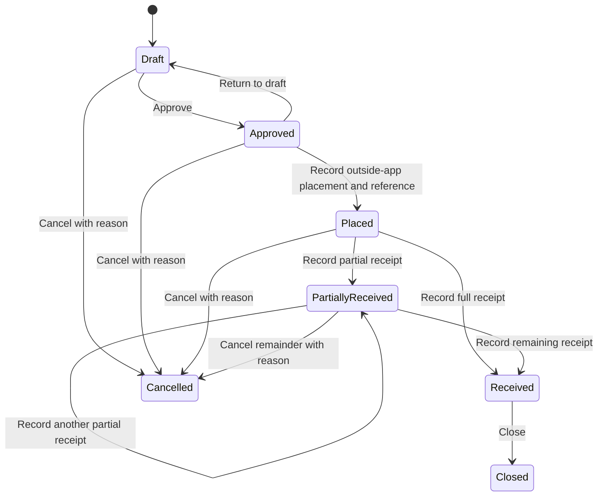

# Separate quotes, internal orders and supplier observations

October 16, 2026. The owner requested an Orders section and corrected quote/order separation, then explicitly selected the internal quote-to-order lifecycle. This extends the imported plan's comparison-only scope. The original plan remains unchanged; live Lenovo discovery remains deferred.

Quotes are offers under evaluation. Supplier approval and calculated eligibility do not place an order. The owner can explicitly create an internal draft from an eligible current offer. The server copies immutable comparison revision, quote, quantity, required date and excluded-cost provenance. A stable seed quote-ID to supplier-alias mapping preserves identity when directory display names change. There is one conversion per quote per workspace generation. Later quote edits cannot rewrite existing order terms or provenance.

Orders has two labeled record types: internal purchase orders and accepted supplier observations. Creating an internal draft never inserts or implicitly matches a supplier observation. Future live matching requires an explicit source identifier mapping instead of a name or amount guess. Internal orders currently contain one item, a scoped active supplier, exact decimal quantity/costs, USD, required date and notes. Terms are editable only in draft.

Placement records an action the owner performed elsewhere, requiring a reference and explicit acknowledgement. Receipt actions add exact positive quantities with receipt references and cannot exceed ordered quantity. Cancellation retains prior receipts and terminates the outstanding remainder. Closed/cancelled orders have no further actions. Each create, edit and transition appends an actor/time event. These local actions do not submit or cancel supplier orders, send messages, or post inventory/accounting entries.

Supplier fulfillment, supplier confirmation and internal receiving remain separate. Derived source lifecycle uses known quantities, preserves unknown balances and flags contradictions. Source-reported delivery does not create an internal receipt. Buyer follow-up completion cannot close an order.

Owner-only mutations work in the owner's private/presentation workspaces; reviewers read their own records. Private orders need no connector. Normal session, Origin, CSRF, current-generation and optimistic revision checks apply. Bounded idempotency keys and workspace locking prevent duplicate receipts and concurrent overwrites. Current-generation RLS, scoped foreign keys and column-level grants protect scope and immutable provenance; runtime events cannot be updated or deleted.

Collection preserves internal orders. Demo reset advances generation and removes visibility of that demo's purchasing records, preserving private data and security audit. Source observations, internal lifecycle and quote comparison keep independent facts and provenance.
